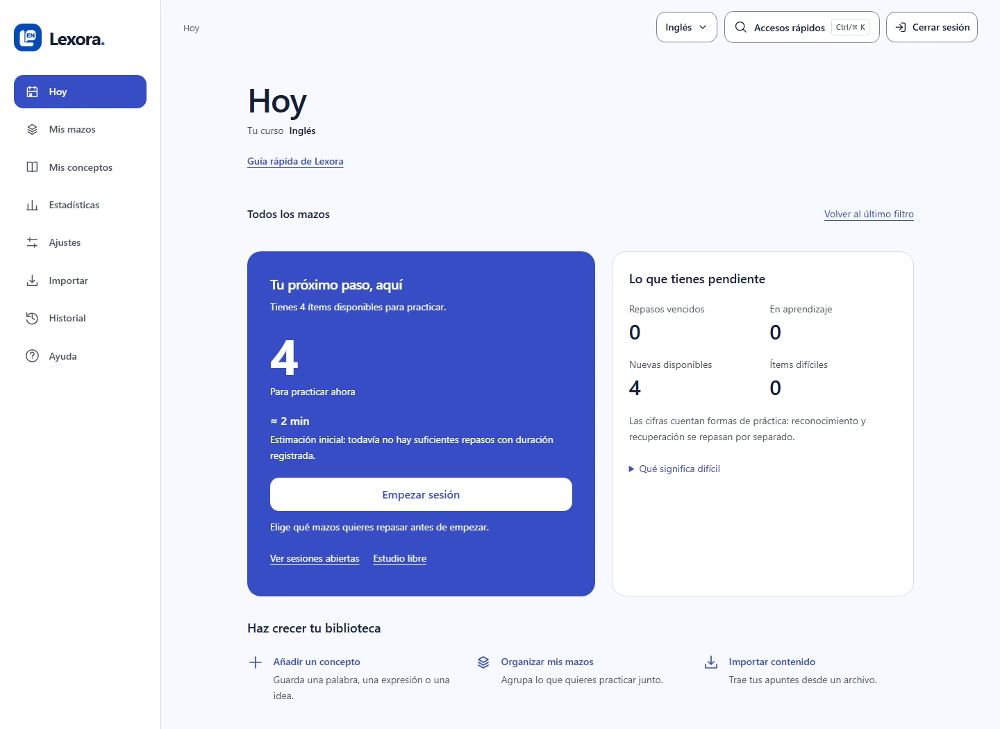
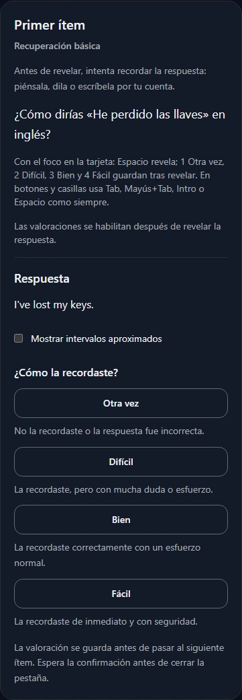

<div align="center">


# Lexora

**Estudio de idiomas con tarjetas y repetición espaciada**

Organiza tu vocabulario, gramática y frases por curso. Crea tus propias tarjetas o importa un tema entero y elige cómo practicarlo.

[Visitar Lexora en español](https://lexora-one-alpha.vercel.app/es) · [Open Lexora in English](https://lexora-one-alpha.vercel.app/en)

</div>

> **Acceso público y gratuito.** Crea una cuenta con Google. Si ya tienes una cuenta con contraseña, puedes seguir usándola. [Crear una cuenta](https://lexora-one-alpha.vercel.app/es/signup)

[Funciones](#qué-puedes-hacer) · [Ejemplo de importación](#importa-un-tema-completo) · [Arranque local](#arranque-local) · [Cómo está construida](#cómo-está-construida)



*Panel Hoy con un curso de inglés y tarjetas de ejemplo.*

## Qué puedes hacer

| Función | Cómo se usa |
| --- | --- |
| **Cursos de idiomas** | Crea un curso vacío con su nombre y el idioma que quieras estudiar. Cambia de curso desde el selector. Cada uno tiene sus propios mazos, tarjetas, progreso y límites diarios. |
| **Biblioteca de tarjetas** | Agrupa contenido en mazos y clasifícalo con etiquetas, categorías y niveles del MCER de A1 a C2. Un concepto puede tener tarjetas de reconocimiento, recuperación o huecos. |
| **Estudio programado** | Abre la cola del día, revela la respuesta y elige **Otra vez**, **Difícil**, **Bien** o **Fácil**. FSRS calcula el siguiente repaso para esa tarjeta. Puedes pausar la sesión y retomarla. |
| **Estudio libre** | Practica desde un mazo o elige varios. Puedes escribir tu respuesta antes de revelarla y marcar tarjetas para volver a intentarlas en una ronda al terminar. El resumen muestra el tiempo y las tarjetas vistas. |
| **Historial y estadísticas** | Filtra los repasos y consulta la actividad, el tiempo registrado, las tarjetas difíciles y los próximos vencimientos del curso activo. |
| **Ayuda integrada** | Sigue la guía de primera sesión, prueba una tarjeta de ejemplo y abre los tutoriales desde **Ayuda** o desde las pantallas de estudio e importación. |

Cada tarjeta tiene su propio estado de memoria. Por ejemplo, puedes practicar el significado de *warm up* con una tarjeta y recuperar la expresión en inglés con otra. Cada una avanza según tus respuestas.

<details>
<summary>Ver una tarjeta revelada en móvil</summary>

<br />


</details>

## Importa un tema completo

1. En **Importar**, elige una plantilla de vocabulario, gramática o frases. Puedes descargar el CSV de ejemplo o copiar un prompt para ChatGPT con el tema, el nivel, la cantidad y el idioma de las respuestas.
2. Sube un TXT o CSV en UTF-8, o pega el contenido directamente. Cada fila contiene frente, reverso y etiquetas. La vista previa permite revisar el mapeo de columnas, las filas válidas y los posibles duplicados.
3. Selecciona un mazo o créalo en el asistente. En **Editar mazo**, **Añadir** omite los frentes repetidos. **Reemplazar** pide confirmación y actualiza el contenido de ese mazo conservando el historial de las tarjetas anteriores.

Este CSV importa una tarjeta de vocabulario con pronunciación orientativa y significado en castellano. Después de la directiva empiezan las tarjetas.

```csv
#separator:comma
Warm up (uórm ap),Calentar antes de hacer ejercicio.,sports verbs
```

[Formato, columnas y manejo de duplicados](docs/IMPORT_FORMAT.md)

## Instalación y copias de tus datos

- **Instala Lexora** desde un navegador compatible para abrirla desde su icono en el móvil o escritorio. Para estudiar y sincronizar hace falta conexión. [Guía de la aplicación instalable](docs/PWA.md)
- **Descarga tus datos** desde Ajustes en JSON o CSV. La copia incluye cursos, mazos, tarjetas, progreso, historial y preferencias. Puedes revisar una copia y restaurarla en la misma cuenta, lo que sustituye sus datos actuales tras la confirmación. [Exportación y restauración](docs/DATA_EXPORT.md)

## Arranque local

Necesitas **Node.js 24** (versión exacta en [`.nvmrc`](.nvmrc)), **pnpm** (versión en [`package.json`](package.json)) y **Docker** en ejecución. Los comandos se ejecutan en la raíz del repositorio.

```bash
pnpm install --frozen-lockfile
pnpm db:start
```

Copia `.env.example` a `.env.local` con `cp .env.example .env.local` en Bash o `Copy-Item .env.example .env.local` en PowerShell. Rellena `NEXT_PUBLIC_SUPABASE_URL` y `NEXT_PUBLIC_SUPABASE_PUBLISHABLE_KEY` con la URL y la clave *publishable* que muestra Supabase local.

```bash
pnpm dev
```

Abre [Lexora local](http://localhost:3000/es), crea una cuenta de prueba y completa el alta del curso. Para aplicar migraciones pendientes a una base local existente, usa `pnpm exec supabase migration up --local`. Reserva `pnpm db:reset` para una base local desechable, ya que elimina su contenido.

### Pruebas y comprobaciones

| Comando | Qué comprueba |
| --- | --- |
| `pnpm check` | Formato, lint, TypeScript, contraste, pruebas de aplicación, verificación de copias y build. |
| `pnpm db:test` | Esquema, permisos y aislamiento de datos con pgTAP. |
| `pnpm e2e` | Flujos en Chromium de escritorio y móvil emulado con el build de producción y Supabase local. |
| `pnpm e2e:compat` | Flujos críticos en Firefox y WebKit. |
| `pnpm ops:recovery:verify` | Ensayo de recuperación con Auth y políticas de acceso en bases locales desechables. |

Para Playwright, instala los navegadores con `pnpm exec playwright install chromium firefox webkit`. Las pruebas de navegador usan la app en el puerto `3100` y Supabase en el `54321`. [Flujo de trabajo y entornos](docs/WORKFLOW.md)

## Cómo está construida

Lexora es un monolito modular con **Next.js App Router**, **React** y **TypeScript**. Usa Tailwind CSS para la interfaz y next-intl para español e inglés. **Supabase** proporciona PostgreSQL y autenticación. Las políticas de acceso por fila (RLS) controlan el acceso a los datos de cada cuenta. GitHub Actions ejecuta la integración continua y Vercel despliega desde `main`. [Arquitectura y módulos](docs/ARCHITECTURE.md)

El adaptador de estudio encapsula [`ts-fsrs`](https://github.com/open-spaced-repetition/ts-fsrs). El dominio conserva un `LearningState` por tarjeta y registra cada valoración en `ReviewLog`. PostgreSQL guarda ambos cambios en una transacción y aplica los límites del curso al confirmar el repaso. Los reintentos de un guardado recuperan el mismo resultado. [Modelo de datos](docs/DATA_MODEL.md) · [Planificador y guardado](docs/FSRS.md)

| Si buscas… | Consulta |
| --- | --- |
| Estado del proyecto y verificaciones | [Estado actual](docs/STATUS.md) · [Evidencia de entrega](docs/evidence/LEX-1.0-personal-acceptance.md) |
| Historial, tiempo y previsión | [Estadísticas](docs/STATISTICS.md) · [Glosario](docs/GLOSSARY.md) |
| Acceso, sesiones y protección del despliegue | [Google Auth](docs/GOOGLE_SIGN_IN.md) · [Seguridad de aplicación](docs/SECURITY.md) · [Seguridad de despliegue](docs/DEPLOYMENT_SECURITY.md) · [Control de abuso](docs/ANTI_ABUSE.md) |
| Conservación, borrado y recuperación | [Ciclo de vida de los datos](docs/DATA_LIFECYCLE.md) · [Recuperación operativa](docs/BACKUP_RECOVERY.md) |
| Decisiones y mantenimiento | [ADR](docs/adrs/) · [Preguntas abiertas](docs/OPEN_QUESTIONS.md) · [Informes de pruebas](docs/evidence/) · [Instrucciones del repositorio](CLAUDE.md) |

## Licencia

La licencia está pendiente de decisión. Todos los derechos reservados. [Política de contenido](docs/CONTENT_POLICY.md)
