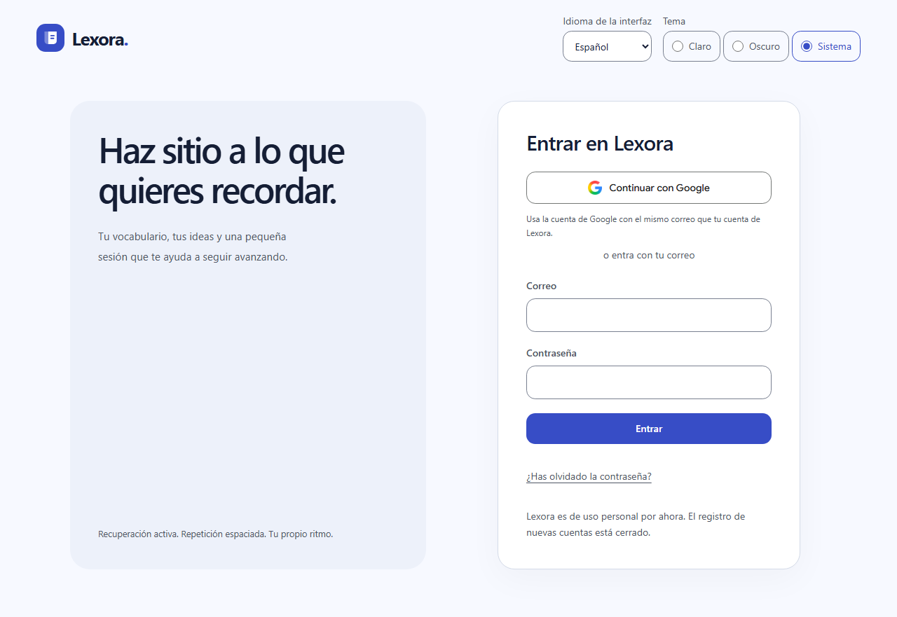
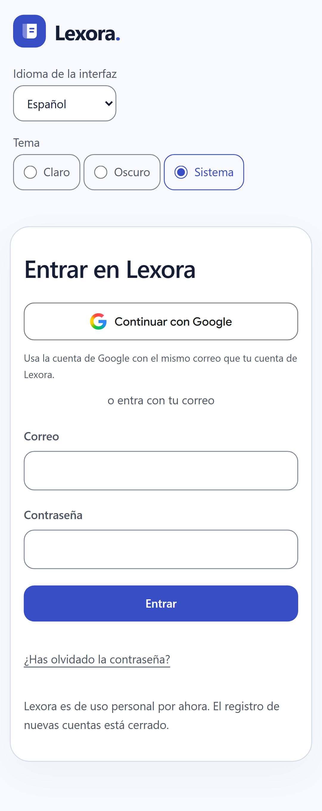

# LEX-15 — Google opcional y renovación personal

**Fecha:** 2026-11-12. Código fijado en `2bb9237`, sobre la entrega personal
`2f50def`. Publicación bajo [PR116](https://github.com/JoanOliver04/lexora/pull/116),
con los checks protegidos Calidad, Base de datos y Extremo a extremo.

Google está implementado como acceso adicional a la cuenta personal existente.
Su configuración externa y primer acceso real siguen pendientes en Q-011.
El registro se mantiene cerrado; no hay SQL ni dependencias de paquete nuevas.
[ADR-011](../adrs/011-personal-google-sign-in.md) y [activación](../GOOGLE_SIGN_IN.md).

## Evidencia local ejecutada

| Comprobación | Resultado |
|---|---|
| `LEXORA_DB_TESTS=1 pnpm check` | PASS: formato, lint, tipos,28 contrastes,962 tests+1 omisión opcional privada,12 tests Node del backup y build |
| Regresión de portada/acceso, Hoy y navegación |18 PASS, ES/EN×escritorio/móvil, sin retries |
| `pnpm e2e:google --workers=1` |8 PASS: ES/EN×Chromium escritorio/móvil, Firefox y WebKit, sin retries |
| Axe en Google/acceso cancelado |32 informes,0 infracciones y0 incompletos, claro/oscuro |
| Pruebas del componente de estudio tras corregir espera de foco |37 PASS; se conserva la misma aserción, esperando el efecto de React |
| Gitleaks8.30.1, snapshot público de693 archivos |0 filtraciones; la CI repite el escaneo del historial publicable |

Google se prueba con el SDK real: URL del proveedor, permisos básicos, desafío
S256, callback canónico con idioma/destino y persistencia del verifier SSR.
Un proveedor sintético devuelve una cancelación al callback real. Se comprueba
el error genérico, ausencia del mensaje remoto, conservación del destino,
campos de correo sin error espurio y acceso alternativo por contraseña.
El backend local está limitado a loopback54321 y las identidades son sintéticas.

El recorrido completo de teclado de Chromium se conserva. En los motores
Playwright de este Windows se reprodujo con HTML mínimo que Firefox no vuelve
al inicio tras el último control y WebKit omite enlaces en Tab por defecto.
Firefox/WebKit ejecutan Axe y prueban la secuencia nativa Tab Google→correo,
Shift+Tab→Google, foco visible de2px y Enter. WebKit no permite `fulfill(302)`;
el proveedor sintético usa un documento200 con meta refresh, atributo escapado
y CSP restrictiva. No cambia CSP ni navegación de la aplicación.

La inspección de capturas320/texto200 detectó una tarjeta rotada muy alta y
padding que consumía el ancho disponible. Ahora los márgenes horizontales
están acotados y la rotación solo se aplica en escritorio. La matriz18 PASS
incluye los seis casos que habían fallado en la primera CI visual.

## Revisión y límites

Tres lentes independientes revisaron `2f50def → 3c0de1d` y el suplemento
`3c0de1d → 426c685`: corrección, seguridad y estándares, sin hallazgos accionables
confirmados. Se revisaron dependencias inmediatas de Auth/SSR/redirects y las
capturas públicas. El cambio posterior `2bb9237` solo espera el efecto de foco
en una prueba, sin cambiar la condición exigida ni el código de la aplicación.
La revisión de seguridad fue estática; no acredita una auditoría exhaustiva
de infraestructura ni el estado efectivo de la configuración de Google.

No se introducen fusiones de cuentas por correo, claves privilegiadas, acceso
a Gmail/Drive, scripts de Google, relajaciones de CSP ni acceso al backend
personal desde Preview. El G oficial se conserva sin alterar; Google Sans se
autoaloja en el build. Las capturas se copiaron sin editar desde pruebas locales.

Estos resultados no acreditan consentimiento Google real, vinculación al UID
existente, instalación física nueva ni una nueva prueba con lector de pantalla.
La aceptación física anterior del propietario se conserva con su procedencia;
no se vuelve a atribuir a este commit. Q-011 solo se cierra tras activar el
proveedor con altas cerradas y comprobar los datos habituales al entrar.
