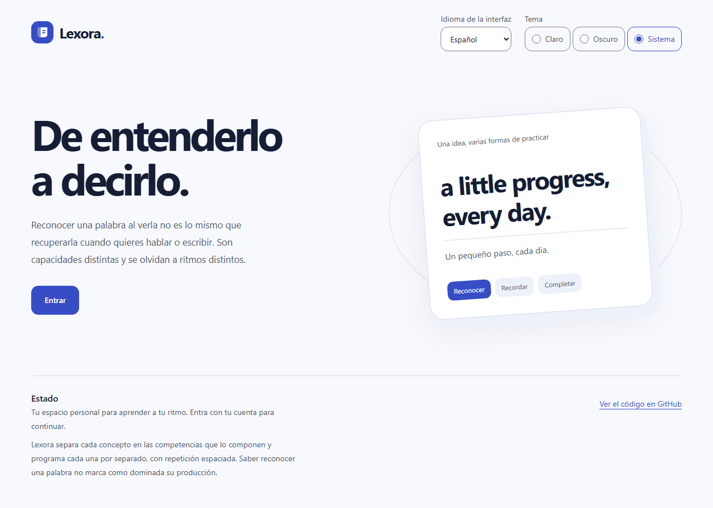
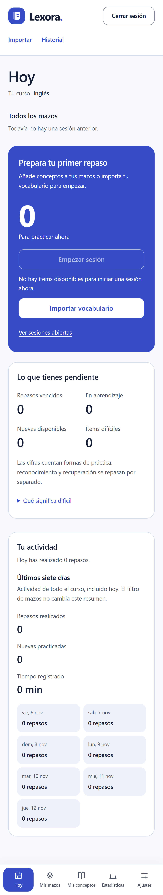

# Dirección visual de Lexora

Encargo12/11/2026: actualizar el diseño de la aplicación personal y añadir Google.
LEX-15.2 aborda presentación/navegación; la política de altas se decide de forma
explícita en LEX-15.1. No se cambia el motor de estudio ni los datos.

## Plan y revisión previa

La interfaz se organiza como un espacio de estudio: biblioteca a mano y una
acción principal de repaso clara. La personalidad procede de la tarjeta de
memoria y de la transición entre reconocer y recordar, sin datos de progreso
inventados ni un mosaico de tarjetas equivalentes.

Paleta de referencia: fondo frío#f4f6fc, papel#ffffff, tinta#17213b,
azul#425bd8, borde#dce6f3 y fondo oscuro#10182c. Se implementa mediante tokens
semánticos OKLCH; el gate calcula las combinaciones reales, no estos aproximados.
Geist Sans existente mantiene lectura y velocidad; números tabulares para
cantidades. Se evita el monoespaciado decorativo y las etiquetas en mayúsculas.

Escritorio: navegación lateral persistente, curso/contexto al comienzo del
contenido y una acción de estudio protagonista. Móvil: marca y acciones
secundarias arriba, navegación principal accesible abajo y contenido en una
columna. La autenticación utiliza una composición editorial de dos zonas en
pantallas grandes y un formulario directo en móvil. Temas con tokens propios.

```text
escritorio                      móvil
marca | página / contexto       marca + acciones
nav   | acción de estudio       contenido
      | actividad y biblioteca  navegación principal
```

Se revisó la propuesta para evitar un dashboard SaaS intercambiable: el recurso
visual principal será la tarjeta/acto de recordar, no gradientes decorativos,
estadísticas falsas o animaciones de entrada repetidas. Sin nuevas librerías
de interfaz ni fuentes. Se reutilizan controles nativos, foco y motion reducido.

## Implementación y primeras comprobaciones

Marca vectorial propia, navegación lateral en escritorio e inferior en móvil,
sección activa y acceso directo al contenido. Portada basada en la tarjeta de
memoria, acceso en dos zonas y sesión destacada en Hoy. Los controles mantienen
su semántica, nombres y acciones. Fuente existente, sin librería o imagen externa.
No se cambia ningún dato ni cálculo de progreso. El registro sigue cerrado.

El primer pase de portada/accesibilidad dio18 E2E PASS y216 análisis A/AA sin
infracciones ni incompletos. Gate local930 PASS+1 material privado omitido,
Node12 PASS y formato/lint/tipos/contraste/build PASS. El contraste de los28
pares mejora hasta mínimo5,09 en texto de apoyo claro y4,77 en oscuro.

La nueva prueba de navegación reprodujo enlaces de biblioteca con área de20px
y un desbordamiento a320px/texto200%. Se amplían enlaces y se acotan campos
flex/select; el pase siguiente4 PASS ES/EN×dos perfiles. La comprobación compartida
compara con el ancho solicitado: en emulación móvil, innerWidth podía ampliarse
para acomodar contenido y ocultar un desbordamiento real.

Se espera a los datos de Hoy y las fuentes antes de capturar. Las capturas usan
cuentas sintéticas locales; no acreditan un móvil físico nuevo. Teclado, estado
actual de ruta, regreso a Hoy, tema del sistema y skip-link se prueban realmente.

## Matriz final local

Commit de interfaz `d3c9727`:8 E2E Chromium PASS, incluidos216 análisis sin
infracciones/incompletos y navegación ES/EN×escritorio/móvil. Firefox/WebKit8,
acceso cerrado4 y Preview4 PASS, todos sin retries. La prueba de navegación
comprueba foco del skip-link, ruta activa y ancho320/texto200%; el CTA de
importación destaca en el estado vacío. Tres revisiones independientes de
corrección, seguridad y estándares cerradas sin hallazgos. Sin SQL/deps nuevas.

Las capturas se copiaron sin modificar desde el navegador local. Datos sintéticos,
sin cuentas ni contenido reales. No se presentan como prueba de un teléfono físico.





## Regresión detectada en CI

La CI43234384937 del head documental `0d15e2d` pasó Calidad y Base de datos,
pero encontró seis fallos E2E: portada320/texto200 en cuatro combinaciones
ES/EN×perfil y selector genérico `form` ambiguo en dos pruebas de Hoy.
196 PASS+4 omisiones; los seis fallos se repitieron en el retry. La matriz local
seleccionada anterior no cubría toda esta regresión. El head no se publicó.

La corrección acota la columna de la portada con `minmax(0,1fr)`, permite corte
de palabras grandes y selecciona el formulario de sesión por su `sessionId`.
Se validará junto a Google, con nueva CI y revisión del head combinado.
